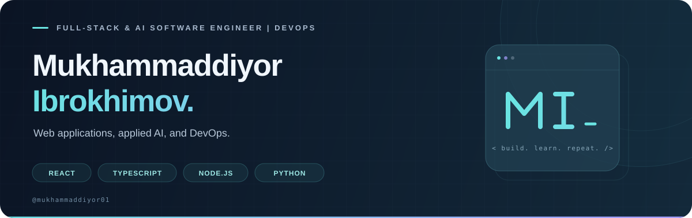

  

  <a href="https://mukhammaddiyor01.github.io/portfolio/"><strong>Portfolio</strong></a>
  &nbsp; / &nbsp;
  <a href="https://t.me/IMR0208"><strong>Telegram</strong></a>
  &nbsp; / &nbsp;
  <a href="https://www.instagram.com/muhammaddiyor_shavkatbek"><strong>Instagram</strong></a>
  &nbsp; / &nbsp;
  <a href="https://github.com/mukhammaddiyor01?tab=repositories"><strong>Explore my repositories ↗</strong></a>

 

## A little about me

I'm **Mukhammaddiyor Ibrokhimov (Adam)**, a **Full-Stack & AI Software Engineer** based in Seoul, South Korea. I build healthcare and commerce applications, PDF research tools, and computer vision prototypes. I use Docker and GitHub Actions to package and deliver applications.

## Experience

- **Quantum Labs, Tashkent** · Full-Stack, DevOps & AI Engineer · Mar 2025–Dec 2025 and Jan 2022–Aug 2023. Built web applications and role-based healthcare workflows, configured Docker and GitHub Actions, and worked on document retrieval, Gemini integration, and computer vision.
- **INWARE IT Company, Andijan** · Backend and Frontend Developer · Apr 2019–Jan 2020. Built Next.js and Express features, integrated GraphQL, and implemented JWT authentication, bcrypt password hashing, and multilingual interfaces.

## Selected work

<table>
  <tr>
    <td width="50%" valign="top">
      01 / HEALTHCARE · LIVE
      <h3><a href="https://mnhospital.uz/">MN Hospital ↗</a></h3>
      
Role-based booking, scheduling, and real-time messaging for patients and hospital staff, with a Gemini assistant grounded in public catalog data. Eximbay checkout runs in sandbox mode.

      
<code>Next.js</code> <code>NestJS</code> <code>GraphQL</code> <code>MongoDB</code> <code>Docker Compose</code>

    </td>
    <td width="50%" valign="top">
      02 / COMMERCE · LIVE
      <h3><a href="https://mnshop.uz/">MNShop ↗</a></h3>
      
An Uzbek-inspired multi-vendor storefront with order tracking, Seller Studio, and a server-rendered admin console.

      
<code>React</code> <code>Redux Toolkit</code> <code>Express</code> <code>EJS</code> <code>MongoDB</code>

    </td>
  </tr>
  <tr>
    <td width="50%" valign="top">
      03 / EXERCISE TRACKING · LOCAL
      <h3>Coach App</h3>
      
Counts push-ups, squats, and stationary lunges from camera frames using body landmarks and joint angles, with live posture and tracking feedback.

      
<code>Python</code> <code>FastAPI</code> <code>MediaPipe</code> <code>OpenCV</code>

    </td>
    <td width="50%" valign="top">
      04 / WILDLIFE RESEARCH · LOCAL
      <h3>WildLifeAI</h3>
      
Screens wildlife photos locally and ranks possible matches across three trained classes: wild boar, hornet, and yellow-legged hornet. It can return no supported match.

      
<code>Python</code> <code>FastAPI</code> <code>BioCLIP</code> <code>PyTorch</code> <code>PostgreSQL</code>

    </td>
  </tr>
  <tr>
    <td width="50%" valign="top">
      05 / PDF RESEARCH · LOCAL
      <h3>DocChat</h3>
      
Finds PDF passages with keyword or local semantic search, links excerpts to original pages, and can draft Gemini answers from passages the reader approves for sharing.

      
<code>Python</code> <code>FastAPI</code> <code>BGE</code> <code>ONNX Runtime</code> <code>Gemini</code>

    </td>
    <td width="50%" valign="top">
      06 / VIDEO REVIEW · LOCAL
      <h3>Sports Replay Analyst</h3>
      
Reviews table tennis clips frame by frame, with manual table calibration, experimental ball tracking, and bounding-box annotation export.

      
<code>Python</code> <code>OpenCV</code> <code>FastAPI</code> <code>JavaScript</code>

    </td>
  </tr>
  <tr>
    <td colspan="2" valign="top">
      07 / FITNESS &amp; NUTRITION · LOCAL
      <h3>TrainAI</h3>
      
Tracks private weight goals and workout readiness. Users can preview, save, and approve calorie target changes and review target history.

      
<code>Python</code> <code>FastAPI</code> <code>Jinja2</code> <code>PostgreSQL</code> <code>SQLAlchemy</code>

    </td>
  </tr>
</table>

## My toolkit

| Area | Technologies |
| :--- | :--- |
| **Languages** | TypeScript · JavaScript · Python · Java |
| **Frontend** | React · Next.js · Redux Toolkit · HTML · CSS / SCSS |
| **Backend & data** | Node.js · Express · NestJS · FastAPI · REST · GraphQL · Apollo · MongoDB · Mongoose · PostgreSQL · WebSockets |
| **DevOps** | Ubuntu · Docker Compose · Nginx · DNS · PM2 · GitHub Actions · GitHub Pages · Render |
| **Applied AI & vision** | RAG · Gemini API · BGE embeddings · ONNX Runtime · PyTorch · OpenCV · MediaPipe · YOLOX |
| **Development & testing** | Git · Postman · Codex · Cursor · pgAdmin · pytest · Jest · React Testing Library |

## One contribution at a time

<picture>
  <source media="(prefers-color-scheme: dark)" srcset="https://raw.githubusercontent.com/mukhammaddiyor01/mukhammaddiyor01/output/github-contribution-grid-snake-dark.svg" />
  <source media="(prefers-color-scheme: light)" srcset="https://raw.githubusercontent.com/mukhammaddiyor01/mukhammaddiyor01/output/github-contribution-grid-snake.svg" />
  
</picture>

 

  <strong>Have an idea? Let's talk.</strong> 
  <a href="https://t.me/IMR0208">Find me on Telegram ↗</a>

